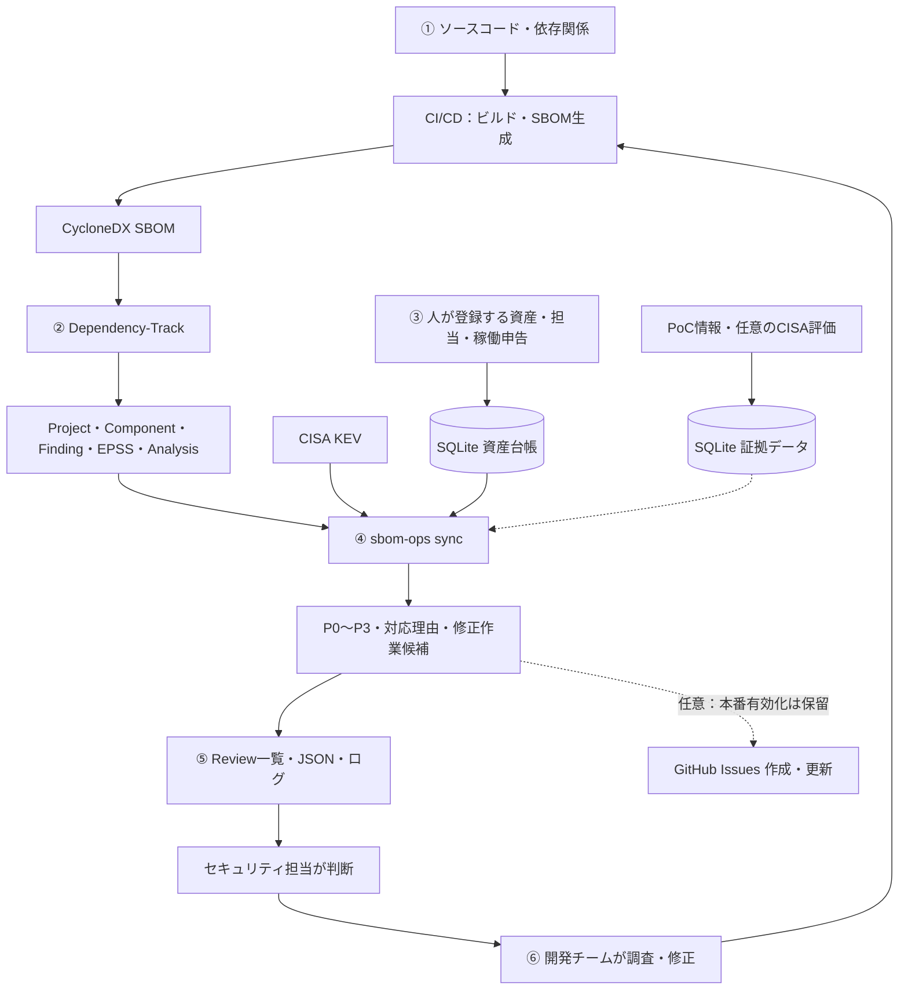

# Dependency-Track SBOM Operations

SBOMから見つかった脆弱性を、サービスの担当者が対応できる仕事につなげるCLIです。

Dependency-Track（DT）がソフトウェア構成と脆弱性・分析状態を管理し、
sbom-opsがKEV・EPSS・CVSSから優先度を計算します。
人が登録したサービス・担当・稼働申告はSQLiteに保存し、DT Projectと照合します。
GitHub Issuesへの同期は任意の最終アクションです。

## 全体の流れ



資産台帳と証拠データは役割を分けて描いていますが、同じSQLite DBに保存できます。
資産とSBOMは、サービス・配布単位・不変の成果物IDと、承認済みDT Project UUIDで結び付けます。
修正後は再ビルド・SBOM更新を経て確認します。Findingの消失や旧版停止だけでは修正完了と判断しません。

## 現在できること

- DTのFinding、EPSS、Analysis、抑制状態を読み、KEVで補完してP0〜P3と理由を出す。
- サービス・配布単位を登録し、人が確認したDT Project対応をSQLiteに保存する。
- 担当・重要度を更新し、変更者・理由・変更前後の履歴を残す。
- 資産の廃止・紐付け撤回を履歴付きで行い、誤った紐付けを再承認で訂正する。
- 稼働・公開状況の申告を期限付きで残し、未確認・期限切れ・矛盾を区別する。
- 任意のJSONからCVEに紐づくPoC有無・情報源別件数を表示する。
- `poc-fetch`で対象CVEのPoC報告を取得し、資産台帳と同じSQLiteへ保存する。
  新しい結果は再利用し、取得失敗時も過去の成功情報を残す。
- 優先度順の確認用一覧に、Finding・サービス・担当・環境・未確認事項をまとめる。
- GitHubを無効にしたまま、テキスト・JSON・任意のJSONLログで結果を確認する。

資産情報は判断の参考として表示し、優先度を自動変更しません。
PoC取得の失敗後は、SQLiteに残した待機時刻まで再取得を見送ります。
定期実行用の[更新スクリプトと運用手順](docs/operations.md#poc更新を定期実行する)を用意しています。
通常のsyncは取得を行いません。
PoCの動作検証は本PJでは行いません。DTの分析判断・抑制・例外承認も自動変更しません。
現在の制限と実装順序は[ROADMAP](ROADMAP.md)を参照してください。

## Quick Start

リポジトリを取得したディレクトリで実行します。Python 3.12以上が必要です。
まずはDocker・APIキー不要の架空シナリオで、出力を確認できます。

```bash
python3.12 -m venv .venv
source .venv/bin/activate
python -m pip install -e ".[dev]"
python examples/review_scenario.py
```

インストールにはネットワークが必要ですが、シナリオ自体は外部通信しません。
4つの架空Projectについて、本番公開・開発環境の矛盾・期限切れ・
資産との対応なしを、担当者付きの一覧で表示します。非CVEのIDやDTの抑制状態も残します。
同じサービスの2ビルドを一組にして、4件のFindingから3組の修正作業候補も表示します。
候補は確認用で、GitHubのIssueをまとめたり作成したりする操作ではありません。
P1→P2の順で並びますが、資産情報で優先度そのものは変わりません。
「P3なら安全」「稼働申告があれば実稼働を証明済み」とは判断しません。

入力は[架空のDT・資産データ](examples/review-scenario.example.json)に保存しています。
承認済みの紐付けを模擬する評価専用入力です。DB保存や実環境での承認は行いません。
JSON出力は `python examples/review_scenario.py --output json` で確認できます。
旧形式の資産JSONを使う比較例は `python examples/asset_scenario.py` で実行できます。

[架空の速報から資産・担当を探す演習](docs/operations.md#架空の速報から資産担当を確認する外部通信なし)
も、Docker・APIキーなしで試せます。CVEの一致・未取得・検索範囲内で一致なしを区別します。

[BOD参照から次の行動を考える演習](docs/operations.md#bod参照の判断支援を架空データで試す)は
`python examples/triage_scenario.py`で実行できます。同じCVEの公開・内部環境、
情報不足・期限切れ・担当未登録を比較し、誰に何を確認するかを確認できます。

SBOM自体の記載状況も、DTやAPIキーなしで確認できます。

```bash
sbom-ops sbom-quality examples/sboms/vulnerable-demo.cdx.json
```

教材の文書9項目と5部品の各8項目、計49件をJSONで報告します。適合認定や署名検証ではありません。
CIで不足項目を必須化する例は[SBOM品質の確認手順](docs/operations.md#sbom最低要素の確認について)を参照してください。

担当変更・紐付け撤回と再承認・資産廃止も、外部接続なしで試せます。
`python examples/asset_update_scenario.py` は一時DBだけを使い、終了時に削除します。
既存の資産台帳は変更しません。実台帳の操作は[担当変更](docs/operations.md#担当重要度を変更する)・[廃止と紐付け訂正](docs/operations.md#資産の廃止と紐付けの訂正)を参照してください。

`python examples/lifecycle_scenario.py` で、同じソースからの再ビルド・新旧並存・旧版停止を
一時DBで試せます。旧版停止後も新版と別環境の旧版を保持し、矛盾・期限切れを区別します。
[入力と確認ポイント](docs/operations.md#架空のsource再ビルドsbom訂正を登録する)も保存済みです。

`python examples/poc_scenario.py` では架空のPoC報告を使い、SQLiteへの保存・読込・再利用と、
報告あり／未観測／取得失敗／期限切れと、再試行の待機を外部接続なしで試せます（一時DBのみ）。
実際の取得は[PoC取得手順](docs/operations.md#poc報告を明示的に取得する)を参照してください。
CVE対応がないIDは、[対応候補の取得手順](docs/operations.md#cve対応候補を確認する)で
OSVの候補をSQLiteに保存・確認できます。期限付き採用後は、
[明示オプション](docs/operations.md#採用したcve対応をpoc取得表示へ使う)でPoC取得・表示につなげられます。
上の架空演習では、この接続と期限切れ・取消も試せます。P0〜P3やDT分析は変わりません。

SQLiteへの登録例も、書き込まずに確認できます。

```bash
sbom-ops assets --db var/assets.sqlite3 import \
  --file examples/asset-registration.example.json
```

プレビューはDBを作成しません。登録方法は[運用ガイド](docs/operations.md#sbomと稼働資産を結ぶ運用フロー一部実装)にあります。

### DTを使って一件確認する

Docker EngineとCompose pluginを用意し、ローカルの評価用DTを起動します。

```bash
docker compose -f examples/dependency-track/docker-compose.yml up -d
curl -fsS -o /dev/null http://localhost:8080/api/openapi.json
```

初回起動には時間がかかります。接続できなければ起動ログを確認し、準備完了後に再試行します。
ブラウザで `http://localhost:8080` を開きます。
新規環境の初期ログインは `admin / admin` です。ログイン後にパスワードを変更してください。
既存環境では現在の認証情報を使います。

続けて[運用担当者向けの初回演習](docs/operations.md#運用担当者向けの初回演習)へ進んでください。
キー作成、サービス登録、SBOMのDTへの直接投入、UI確認、紐付け承認、
読み取り専用の同期まで、必要なコマンドを順番に掲載しています。
最初はFindingを一件選び、DT画面とCLIの値・判断理由を照合します。
GitHubの認証情報は不要です。

## 設定と日常のコマンド

設定例は[examples/config.yaml](examples/config.yaml)です。
優先順位はCLI → 環境変数 → YAML → 既定値。`.env`は自動読込しません。
秘密情報は環境変数に置き、YAMLでは `env:変数名` で参照します。

演習で設定したDTのURL・読み取りキー・Project UUIDを使う例です。

```bash
sbom-ops plan --config examples/config.yaml --no-github
sbom-ops sync --config examples/config.yaml \
  --project "$SBOM_OPS_DT_PROJECT_UUID" --asset-db var/assets.sqlite3 \
  --wait-for-analysis --dry-run --no-github --output review
```

詳細テキストは `--output text`、JSONは `--output json` に切り替えます。
`--wait-for-analysis` は応答の安定確認であり、全解析完了の証明ではありません。
GitHub連携は既定で無効です。Quick startでは環境設定に影響されないよう、当面 `--no-github` を指定してください。
[既知の課題](ROADMAP.md#github同期を有効にする前の必須事項)を解消するまで本番への書き込みは保留します。

## 開発と検証

```bash
ruff check src tests
pytest -q tests
make dt-lab-test PYTHON=.venv/bin/python
make exploit-lab-test PYTHON=.venv/bin/python
```

labは製品パッケージに含まれません。実験手順・権限・削除方法は各labのREADMEに集約します。
生の結果、認証情報、自社資産情報はGitへ保存しません。

## Documentation

| 知りたいこと | 読む文書 |
| --- | --- |
| 操作手順・初回演習・資産登録 | [運用ガイド](docs/operations.md) |
| 現在の実装仕様と制約 | [SPEC](SPEC.md) |
| 次の作業・優先順位・完了条件 | [ROADMAP](ROADMAP.md) |
| 構成と責任分担 | [ARCHITECTURE](ARCHITECTURE.md) |
| 対応判断の考え方 | [優先度方針](docs/priority-policy.md)・[ユースケース](docs/use-cases.md) |
| DTの導入・API | [DTガイド](docs/dependency-track/README.md) |
| 情報源と判断の背景 | [データソース](docs/data-sources.md)・[ADR](docs/adr/README.md) |
| 検証手順と観測事実 | [DT lab](lab/dependency_track/README.md)・[Exploit Intelligence lab](lab/exploit_intelligence/README.md) |
| Google Cloudを導入する場合 | [基盤PoC](infra/gcp/poc/README.md) |

操作は運用ガイド、仕様はSPEC、未完了の計画はROADMAP、実験結果は各labの
EXPERIMENTSに記録します。同じ手順や実験日誌を入口の文書へ重複掲載しません。
