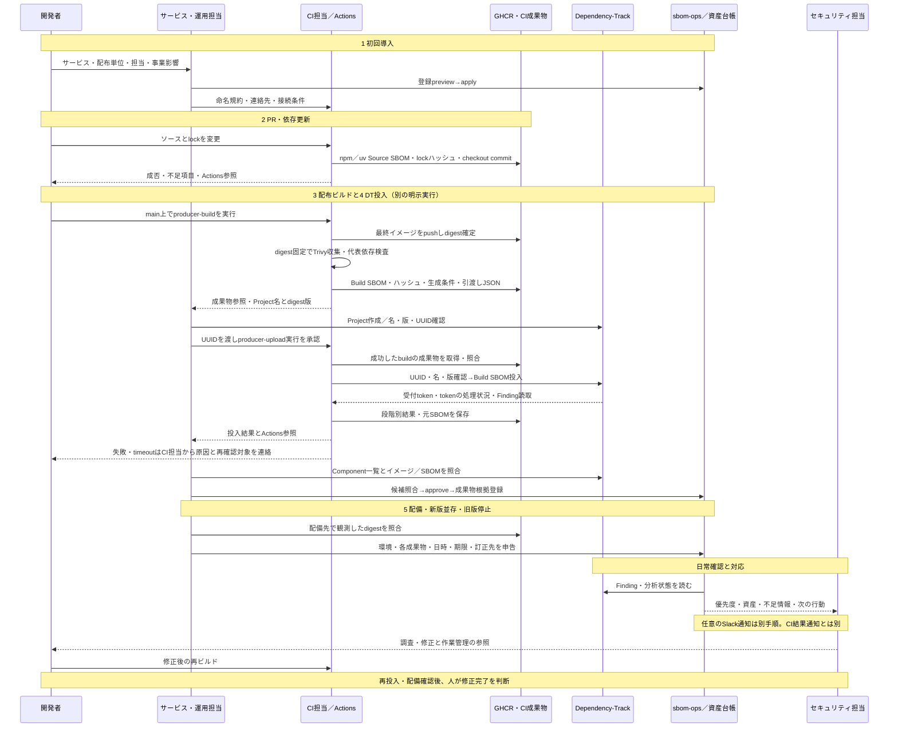

# npm・uv・Trivyから資産登録へつなぐ

開発者・CI担当・運用担当が、架空の`checkout-api`を登録し、配布したイメージを
Dependency-Track（DT）と資産台帳で追跡する手順。
[作業別の入口](operations.md)／[利用シーン](use-cases.md)へ戻る。
サンプルは[npm版・uv版](../examples/sbom-producers/)の二つの配布単位。
既存プロジェクトのパッケージ管理を変更する手順ではない。

## 担当と引渡しの流れ

実線は操作・成果物の引渡し、破線は結果の返却・連絡。
CI担当はActionsの失敗を引き受け、サービス・運用担当は資産と配置を確認する。



| 工程 | 受取担当 | 渡すもの／保管先 | 次の手順 |
| --- | --- | --- | --- |
| 初回登録 | CI担当 | サービスID・配布単位・担当・DT命名規約。資格情報は別のEnvironment Secrets | [導入条件](#導入条件を決める) |
| PR結果 | 開発者 | 成否・Source SBOM・lockハッシュ・checkout commit・実行リンク／Actions artifact | [Source生成](#2-source-sbomを生成する) |
| ビルド成功 | 運用担当 | registry digest・元Build SBOM・補足依存記録・ハッシュ・CI参照・DT予定名／版／build artifact | [Project確認と投入](#4-projectを確認して投入する) |
| 投入後 | 運用担当 | 上記＋UUID・受付token・BOM処理・Finding読取結果／upload artifact | [照合と承認](#5-資産への対応付けと配備申告) |
| 失敗／timeout | CI担当（依存やビルド原因は開発者） | 失敗段階・残った結果・実行リンク。投入結果不明なら運用担当にも連絡 | [失敗時](#失敗時と再実行) |
| 配備／停止 | 運用担当 | 配備先の実測digest・環境・日時・期限・確認者／資産台帳 | [新旧並存](#新版並存旧版停止sbom訂正) |
| 対応候補 | セキュリティ担当→開発者 | DT・詳細結果・手動作業管理の参照 | [日常操作](daily-operations.md)／[任意Slack](slack-notifications.md) |

連絡の基本はActionsの結果画面と受取担当が読めるartifactの参照。
能動通知の経路・宛先・失敗時の当番は導入時に決める。本例はメール・Slackを送らない。
生SBOMや秘密情報をチャットに貼らない。CIの成功は解析完了・修正完了を意味しない。

## 導入条件を決める

| 入力 | このサンプルの値 | 実導入で決めること |
| --- | --- | --- |
| サービス／配布単位 | `checkout-api/npm`、`checkout-api/uv` | サービス担当がIDと担当・事業影響を合意 |
| DT名／版 | `service/deployable`／`sha256:<manifest digest>` | 新しいdigestは別Project。SourceをこのProjectに送らない |
| プラットフォーム | `linux/amd64`、Debian bookworm | 複数archは各manifestを別成果物として検証。indexとchildを混同しない |
| 生成器 | Node 22.16.0＋npm 10.9.2、uv 0.11.21、Trivy 0.69.3 | [固定digest一覧](../examples/sbom-producers/tools.env)をレビューして更新 |
| ベース | Node 22.16.0-bookworm-slim、Python 3.12.11-slim-bookworm | Dockerfileでtag＋digest固定。最新版・安全版の推薦ではなく検証用基準 |
| レジストリ | GHCR、`SBOM_IMAGE_PREFIX=ghcr.io/組織/checkout` | 小文字名、パッケージへのActionsアクセス、公開範囲 |
| DT到達方法 | HTTPSのAPIサーバURL | hosted runnerから到達可能な経路・TLS信頼。localhostやUI URLは使えない |
| 保管期間 | PR artifact 14日、Build／upload artifact 30日 | 配布物の使用期間を覆う保管先へ運用担当が期限前に移管 |
| 初回受付 | 架空の`team-checkout` | 実在する担当・CI当番・承認者・判断記録先 |

固定版で生成できることは、パッケージの安全性・SBOM完全性の保証ではない。
レジストリ保持とCI証拠の保持を合わせて設計する。
artifact名だけで特定せず、実行ID・commit・artifact IDと保存先を記録する。

[Actions例](../examples/sbom-producers/workflows/)は教材として保存してあり、自動起動しない。
導入先で3ファイルを同名のまま`.github/workflows/`へ配置し、サンプル・`src/sbom_ops/clients/`
を含む本リポジトリ相当のツリーで使う。別リポジトリへ移す場合は製品クライアントの
配布方法と固定版を先に決める。スクリプトを貼るだけでDT API実装を複製しない。

- `producer-source.yml`: `pull_request`、contents readのみ。fork PRにもDT／GHCR秘密は渡さない。
  `pull_request_target`や特権`workflow_run`へ置換しない。PRではGitHubのmerge commitを
  checkoutするため、保存されたcheckout commitをPR head SHAと混同しない。
- `producer-build.yml`: mainからの`workflow_dispatch`、`sbom-producer-release` Environment。
  レビュー承認・mainだけを許可するdeployment branch ruleを設定。GHCR書込はこのjobのみ。
- `producer-upload.yml`: mainからの`workflow_dispatch`、別の`sbom-producer-upload` Environment。
  `DT_BASE_URL`をEnvironment variable、`DT_UPLOAD_KEY`・`DT_READ_KEY`を別々のEnvironment Secretへ設定。
  入力のbuild実行がmain／手動／成功／指定workflowであることを確認し、同一repoのartifactを取得。
  生成時commitとハッシュを照合してから、秘密を投入stepだけに渡す。

Actionsはfull commit SHA、生成器とベースはdigestで固定する。Docker/GitHub CLI等の
hosted runner付属ツール・OSパッチまでは再現固定していない。厳密再現にはrunnerも管理する。
アップロードキーには`BOM_UPLOAD`、読取キーには`VIEW_PORTFOLIO`・
`VIEW_VULNERABILITY`を与え、両チームに対象ProjectのACLアクセスを設定する。
Project作成権限やAnalysis変更権限をCIキーへ与えず、Project作成は運用担当が行う。
[操作別権限表](dependency-track/api.md)と対象DTのOpenAPIを照合する。
この例は最小権限の独立実機検証済みという主張ではない。

DT通信経路がなければ、組織で承認されたrunner／private接続を用意する。
PRコードを秘密を持つ永続runnerへ流さない。TLS検証を無効にして解決しない。
CIから資産SQLiteへの接続は作らない。

## 1. 資産を登録する

**担当:** サービス・運用担当。**前提:** `sbom-ops`が導入済み。
**入力:** [登録JSON](../examples/sbom-producers/registration.json)。実際の担当に置換してレビューする。
以下は新規演習台帳。既存DBには[バックアップ・移行](assets.md#将来の資産収集と台帳の保管)を先に行う。

```bash
mkdir -p var/producer-operations
sbom-ops assets --db var/producer-operations/assets.sqlite3 import \
  --file examples/sbom-producers/registration.json
# previewのサービス・担当・配布単位を確認して保存
sbom-ops assets --db var/producer-operations/assets.sqlite3 import \
  --file examples/sbom-producers/registration.json --apply
sbom-ops assets --db var/producer-operations/assets.sqlite3 list
```

**期待結果:** 1サービス・2配布単位が登録される。まだDT承認・稼働申告はない。
入力エラーなら台帳へ保存せずJSONと既存登録を確認する。
[登録の詳細](assets.md#登録単位と新規サービスの開始順序)。

## 2. Source SBOMを生成する

**担当:** 開発者／CI担当。**前提:** Docker、外部パッケージ取得経路。資格情報は不要。
リポジトリルートから実行し、PR用成果物をBuild用と別の場所へ保存する。

```bash
mkdir -p var/producer-source
sha256sum examples/sbom-producers/npm/package-lock.json examples/sbom-producers/uv/uv.lock \
  > var/producer-source/locks.sha256
bash examples/sbom-producers/source.sh npm > var/producer-source/npm-source.cdx.json
bash examples/sbom-producers/source.sh uv > var/producer-source/uv-source.cdx.json
sha256sum --check var/producer-source/locks.sha256
```

**期待結果:** 両方CycloneDX 1.5、lock不変。Sourceはソース／lockの依存関係を表す。
この出力をDTのBuild Projectに投入しない。生成失敗で空ファイルが残る場合も成功と扱わない。

| 条件 | npm例 | uv例 |
| --- | --- | --- |
| lock更新禁止 | `npm ci`でmanifestとの不整合を拒否。その後`npm sbom --sbom-format cyclonedx --package-lock-only` | `uv export --locked --format cyclonedx1.5`。不整合なら失敗。`--frozen`で古いlockを無条件採用しない |
| dev依存 | `--include=dev`で`is-number`を収録 | `--all-groups`で`packaging`を収録 |
| optional | `--include=optional`で`ansi-regex`を収録 | `--all-extras`で`sniffio`を収録。配布はextras未選択 |
| workspace | この例は単一package。複数なら対象`--workspace`／`--workspaces`を指定してroot inclusionも確認 | この例は単一project。複数なら`--package`／`--all-packages`を明示し各配布単位と照合 |
| platform | lockには現在のOSで未導入のoptional候補が含まれ得る | universal lock／markerは実際のPython・OSへのインストール結果と異なる |
| 不足 | lock-onlyでは実パッケージの説明等が省略され得る。OSやbundle後の実体は表さない | CycloneDX exportはpreview。Python依存の解決情報でありOSやwheelの実配置ではない |

npmのlifecycle scriptsはこの教材では不要なので`--ignore-scripts`。
実製品でnative addon等を必要とする場合、無効化したまま配布しない。
必要なビルド処理とSBOM収録を別途検証する。出力中のlifecycleラベルだけでSource/Buildを分類しない。
この例では「何から、いつ生成したか」を引渡し契約で分類する。

仕様参照: [npm sbom](https://docs.npmjs.com/cli/v10/commands/npm-sbom/)、
[uv export](https://docs.astral.sh/uv/concepts/projects/export/)、
[uv lockの確認](https://docs.astral.sh/uv/concepts/projects/sync/)。

## 3. 最終イメージからBuild SBOMを生成する

**担当:** CI担当。**前提:** protected main・GHCR・Environment設定済み。
Actions画面で`producer-build`を選び、`npm`または`uv`を指定する。
これはGHCRへサンプルイメージを公開範囲設定に従ってpushする操作。
ローカル生成だけなら次のビルドを行い、組織のレジストリへpushしてdigestを確定する。

```bash
docker build --platform linux/amd64 -t checkout-npm:example examples/sbom-producers/npm
docker build --platform linux/amd64 -t checkout-uv:example examples/sbom-producers/uv
```

workflowは最終イメージをpush後、`repository@sha256:...`でTrivyから直接読む。
`latest`やmutable tagを収集対象にしない。単一archのmanifestを扱い、Buildxの
自動attestation／SBOM付与は無効にしてindexとの取り違えを避ける。
これは署名・provenance検証を提供する例ではない。

手動で同じ収集を行う場合、`IMAGE`はpush結果で確定したdigest参照へ置換する。
private registryの資格情報は環境変数で渡し、引数や出力へ書かない。

```bash
source examples/sbom-producers/tools.env
mkdir -p var/producer-build
# IMAGE=ghcr.io/your-org/checkout-npm@sha256:実際の64桁digest
: "${IMAGE:?set an immutable image reference}"
docker run --rm --user "$(id -u):$(id -g)" --tmpfs /tmp:rw,nosuid,nodev,mode=1777 \
  -e TRIVY_USERNAME -e TRIVY_PASSWORD "$TRIVY_IMAGE" image \
  --cache-dir /tmp/cache --image-src remote --platform "$PLATFORM" \
  --format cyclonedx --scanners license --skip-db-update --skip-java-db-update \
  --offline-scan "$IMAGE" > var/producer-build/build.cdx.json
# この時点のcheckoutは実際にbuildしたcommitに対応させる
PYTHONPATH=src python3 examples/sbom-producers/handoff.py prepare \
  --bom var/producer-build/build.cdx.json --image "$IMAGE" --producer npm \
  --revision "$(git rev-parse HEAD)" --run '実際のCI実行参照' \
  --output var/producer-build/handoff.json
```

**期待結果:** CycloneDX 1.6の元文書、`handoff.json`、CI artifact中の補足依存情報。
helperはcontainer名と指定digest参照、代表アプリPURL、Debian libc6のdistro付きPURLを確認する。
全依存の完全性・署名・脆弱性判定は確認しない。元文書をDTの再出力に置換しない。
`--offline-scan`は依存補完を抑える指定で、registry取得までオフラインにするものではない。
このコマンドは脆弱性DBを使う評価ではない。

配布時の設定はnpm=`npm ci --omit=dev`、uv=`uv sync --locked --no-dev`（extrasなし）。
npmには`picocolors`とoptionalの`ansi-regex`、Pythonには`idna`が入る。
ベースに含まれるnpm/pip/uv等の依存も収録され得るため、アプリ依存数だけとは一致しない。
SBOMでは名前だけでなくエコシステム付きPURL・版・配置パスを確認する。

### 検出漏れを扱う

Trivyは、コンテナ中のnpm `node_modules/**/package.json`やPythonの
`.dist-info/METADATA`等を手がかりにする。
単一JS bundleへ埋め込まれたコード、METADATAを取り除いたPythonコピー、zipappや
独自パッケージ形式には、このサンプルで確認した収録範囲をそのまま適用できない。
ローカル対照実験では、picocolorsのJS実体を単一ファイルへコピーしてnode_modulesを除いた
イメージと、idnaのコードを残してdist-infoだけを除いたイメージはどちらも実行できたが、
Trivy 0.69.3では各アプリPURLを収録しなかった。handoff検査は両方を拒否した。
これは二つの具体的な配布形態の観測であり、全bundler／zipappを検証した結果ではない。
[Node.jsの対象](https://trivy.dev/docs/latest/coverage/language/nodejs/)、
[Pythonの対象](https://trivy.dev/docs/latest/coverage/language/python/)。

Dockerfileは最終インストール直後にnpmの`npm ls --omit=dev --all --json`、Pythonの
`uv pip freeze`を補足記録として保存する。CIは同じdigestのイメージからこの記録を取り出す。
不足があれば、そのインストール記録・bundle manifest・wheel一覧・ビルドログを
運用担当へ渡し、収集器や配布形態を見直す。補足記録とSource SBOMをBuildへ機械的にmergeせず、
代表依存検査を無効化して成功へ読み替えない。

## 4. Projectを確認して投入する

**担当:** 運用担当がProjectを確認し、CI担当が明示実行する。
**入力:** 成功したbuildのartifact、`handoff.json`、そのbuild実行ID。
運用担当はDT UIでProject名=`checkout-api/npm`（または`checkout-api/uv`）、
版=`sha256:<イメージmanifest digest>`のProjectを作成／確認し、そのUUIDを渡す。
同名・同版が複数ある場合は止める。新しいdigestで既存Projectを上書きしない。

`producer-upload`を選び、build実行ID・producer・Project UUIDを指定する。
Environmentで対象を承認した後、例のhelperがDTからUUID・名前・版を読み直す。
Source artifactを選ぶ経路はない。API操作は既存製品クライアントだけを使う。

ローカルで入力確認する場合、artifactを新しい作業ディレクトリへ展開する。
次は既定で外部通信・送信・結果ファイル作成をしない。

```bash
PYTHONPATH=src python3 examples/sbom-producers/handoff.py upload \
  --handoff var/producer-build/handoff.json --bom var/producer-build/build.cdx.json \
  --project "$PROJECT_UUID" --result var/producer-build/upload-result.json
```

送信は同じコマンドへ`--execute`を追加する。
`SBOM_OPS_DT_BASE_URL`（HTTPS）、`SBOM_OPS_SBOM_UPLOAD_API_KEY`（送信）、
`SBOM_OPS_DT_API_KEY`（照合・読取）を安全な実行環境で設定する。
キーをコマンド履歴に直接記載しない。
helperは名前・版・UUIDの照合後、送信意図を結果ファイルへ保存してから1回だけuploadする。
同じ結果ファイル名での再実行は拒否し、失敗応答の生本文やキーは保存しない。

| 結果フィールド | 意味 | 意味しないこと |
| --- | --- | --- |
| `acceptance=accepted` | DTからupload tokenを受領 | BOM処理・脆弱性解析の完了 |
| `acceptance=unknown` | 送信を開始したが確定応答なし | 未受付・安全に再送可能 |
| `bom_processing=token_idle` | 受領tokenに対応する処理が現在ない | 全analyzer・外部データ・後続メタデータ処理の完了 |
| `findings=read`＋件数 | その時点の読取が成功 | 全件の解析完了・ゼロ件なら安全 |
| `analysis_complete=unverified` | 解析完了をこの例では証明しない | 修正完了・抑制・優先度変更 |

[DTのCI仕様](https://docs.dependencytrack.org/usage/cicd/)と
[token APIの公式実装](https://github.com/DependencyTrack/dependency-track/blob/4.14.3/src/main/java/org/dependencytrack/resources/v1/EventResource.java)
を根拠とする。tokenの`false`自体はtokenの妥当性も証明しないため、受付で受領したtokenだけを使う。

## 5. 資産への対応付けと配備申告

**担当:** 運用担当。**前提:** 対象artifactとDT ProjectのComponentsを読み比べ済み。
**期待結果:** 同じdigestをCI、元SBOM、DT版、台帳artifact IDで追跡できる。
投入後に`source_revision`だけで対応を推測せず、下記を照合する。

| 確認対象 | 一致させる値 |
| --- | --- |
| registry／実際の配備 | `repository@sha256:manifest`、platform |
| Trivy元文書 | metadata.component.name／PURL／RepoDigest。ImageIDは別種のdigest |
| CIのhandoff | image、artifact_digest、sbom_digest、source_revision、build_ref |
| DT | Project UUID、`service/deployable`、版=`artifact_digest`、代表Components |
| 台帳 | 承認済みProject、artifact_id=`DT版`、artifact_digest、元SBOM参照 |

```bash
sbom-ops assets --db var/producer-operations/assets.sqlite3 candidates
sbom-ops assets --db var/producer-operations/assets.sqlite3 approve \
  --service checkout-api --deployable npm --project "$PROJECT_UUID" --reviewer your-name
```

`candidates`と`approve`には運用担当のDT読取設定が必要。
`approve`は再照合して保存する操作であり、名前一致だけの自動承認ではない。
[候補照合の詳細](assets.md#dtから読み戻して紐づける方法)。

CIの引渡しを確認後、運用担当が下記JSONを作る。`<>`は実値に置換し、
元文書を長期保管した参照を使う（artifact期限後も読める場所）。
そのまま投入する架空UUIDや偽hashは提供しない。

```json
{
  "schema_version": 1,
  "service_id": "checkout-api",
  "deployable_id": "npm",
  "actor": "<確認者>",
  "kind": "build",
  "source_repository": "<実際のrepository URL>",
  "source_revision": "<handoff.source_revision>",
  "artifact_id": "<handoff.project_version>",
  "artifact_digest": "<handoff.artifact_digest>",
  "sbom_ref": "<元Build SBOMの長期保管先>",
  "sbom_digest": "<handoff.sbom_digest>",
  "build_ref": "<handoff.build_ref>",
  "observed_at": "<確認したUTC日時>"
}
```

```bash
sbom-ops assets --db var/producer-operations/assets.sqlite3 evidence-register --file build-evidence.json
sbom-ops assets --db var/producer-operations/assets.sqlite3 evidence-register --file build-evidence.json --apply
sbom-ops assets --db var/producer-operations/assets.sqlite3 evidence-history --service checkout-api --deployable npm
```

実際の配備先でdigestを確認してから、環境・日時・期限を申告する。
`report-deployment`は即時保存するので、値を確認して実行する。

```bash
sbom-ops assets --db var/producer-operations/assets.sqlite3 report-deployment \
  --service checkout-api --deployable npm --artifact "$IMAGE_DIGEST" \
  --environment production --status deployed --exposure unknown \
  --reviewer your-name --evidence "$DEPLOYMENT_EVIDENCE" \
  --observed-at "$OBSERVED_AT" --valid-until "$VALID_UNTIL"
sbom-ops assets --db var/producer-operations/assets.sqlite3 list
```

`IMAGE_DIGEST`はtagやImageIDではなく、Project版と同じ`sha256:manifest`。
`DEPLOYMENT_EVIDENCE`は配備先の実観測、日時はUTC ISO 8601で、期限は組織で決める。
未観測なら稼働を推定しない。CI成功は配置申告の根拠にはならない。

### 新版並存・旧版停止・SBOM訂正

1. 新版BをビルドしたらBのdigestで別Projectへ投入し、同じ配布単位に追加承認する。
   同じcommitの再ビルドでもdigestが異なれば別成果物。
2. Bをproductionに配備して申告する。Aの申告を消さない。A/Bの同時稼働が表現できる。
3. Aの停止を実際に確認し、Aのartifactと環境を指定して`--status not_deployed`で申告する。
   先行A申告IDを`--supersedes-report`で指定し、理由を`--evidence`へ記録する。
   AのFinding・元証拠・履歴は残す。Bの稼働やAのstaging申告に波及させない。
4. イメージ不変でSBOMだけを訂正する場合、Project／artifact digestは維持し、
   修正した元SBOMを別名と新しいhashで保管する。根拠JSONの`supersedes_id`・
   `reason`を指定してpreview→apply。新たな投入記録で同じProjectへ送る。
   古いCI artifactを改変して再利用しない。収集設定変更のレビューと訂正用build artifactが必要。
5. 同一digestの再配備は配置申告だけを更新する。新CVE公開だけでは再ビルド・再投入しない。

[同一サービスの架空ライフサイクル演習](assets.md#ライフサイクルで情報を混同しないための確認)は、
資格情報なしで登録・根拠訂正・新旧並存・停止・保持を確認できる。
`python examples/lifecycle_scenario.py --output json`を実行する。
これはDTへの実投入や実デプロイの検証を代替しない。

## 失敗時と再実行

| 段階 | 確認すること | 引受担当・再実行条件 |
| --- | --- | --- |
| Source生成 | lockとmanifest、生成器版、optional/platform、ネットワーク | 開発者＋CI担当。lock修正をレビューしPRを再実行 |
| Build／push | ビルドログ、registry権限、pushされたdigestの有無 | CI担当。tagだけを見て以前の成果物を送らない |
| Trivy／handoff検査 | 元文書の対象、代表OS／アプリPURL、同じイメージの補足証拠 | CI担当＋開発者。不足原因を解消して再収集。Sourceで穴埋めしない |
| artifact取得 | 実行ID・workflow・main・成功・commit・保持期限 | CI担当。別PRや失敗runの成果物へ切り替えない |
| UUID照合 | Project ACL、UUID、名前、版、重複 | 運用担当。正しいProjectを確認するまでuploadしない |
| upload失敗／timeout | resultの受付段階、DT側の受付・Components・token、認証／権限 | CI担当→運用担当。応答喪失を未送信とみなさず無条件再送しない |
| BOM処理timeout | 受領token、DTジョブ・ログ・DB状態 | 運用担当。待機の再確認とBOM再送を分ける |
| Finding読取失敗 | 権限・DT状態・部分読取 | 運用担当。空の成功一覧へ読み替えない。読取を再確認するだけでBOMを再送しない |
| 結果保存失敗／取消 | Actionsログと残ったintent／token、DT側 | CI担当。成功扱いせず外部状態を照合。結果ファイル不在は未送信の証拠ではない |

helperはHTTP自動再試行0回、BOM待機300秒（各HTTP要求時間が加わる）で実行する。
結果が不明なままActionsの「Re-run」を押すと再送になるため、先に状態確認する。
正当な再送でも別の実行／結果名を使い、前回の参照と理由を残す。
[一般の投入障害手順](sbom-input.md#投入後の確認と失敗時対応)。
停止する場合はupload workflow／Environmentの承認を止める。既存DT inventoryや台帳を
削除しない。誤ったSBOMは正しい同一成果物の元文書で訂正し、誤リンクは
[撤回・再承認](assets.md#資産の廃止と紐付けの訂正)する。

## 検証記録と適用範囲

サンプルの固定ツールによるSource／Build実出力と、模擬DTの失敗・重複実行・
ハッシュ不一致・別Project拒否を検証する。[テスト](../tests/integration/test_producer_handoff.py)。
限定DT検証を実行した場合は[実験台帳](../lab/dependency_track/EXPERIMENTS.md)へ記録する。
進捗・公開・CIの確認は[#27](https://github.com/DharmaDoll/sbom-ops/issues/27)で管理する。
Actions例のローカル検証と、実際のGHCR・Environment・DT通信経路での成功を区別する。

AGENTS.md指定のDT資料を確認する。`/usage/vex/`と`/usage/analysis/`は調査時404だったため、
[Analysis States](https://docs.dependencytrack.org/triage/analysis-states/)と
[公式VEX説明](https://docs.dependencytrack.org/usage/executive-order-14028/)も参照した。
本手順はVEX／Analysis／抑制・例外承認を変更しない。
[GitHubのActions保護](https://docs.github.com/en/actions/security-for-github-actions/security-guides/security-hardening-for-github-actions)
に従い、fork PRの秘密分離、最小権限、SHA固定、Environment承認を維持する。
