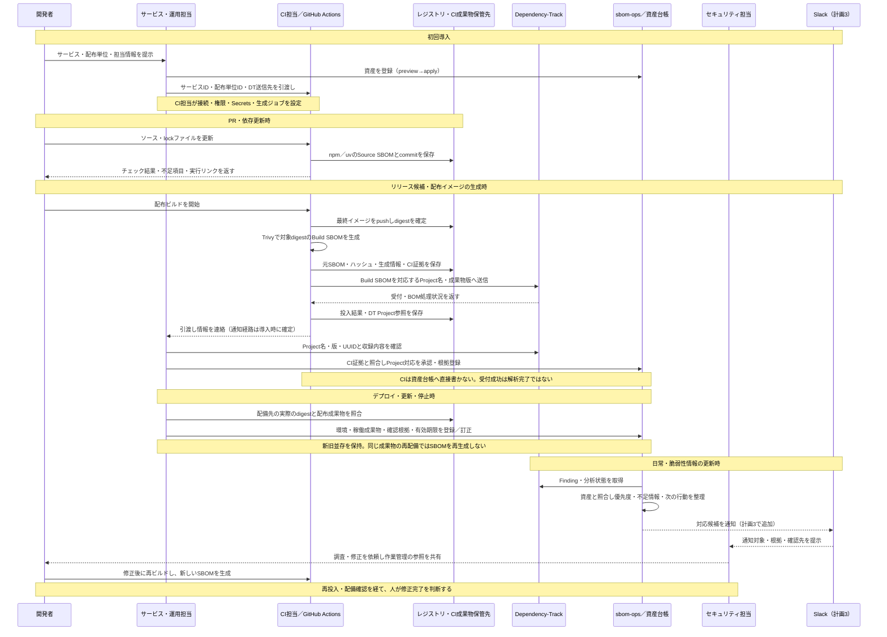

# 今後の作業計画

## 2026-10-29：利用者向け導線・SBOM供給・Slack通知

依頼された3件を独立した計画として保存する。調査基準は
`96d3a94219cf9fe9267ecdbccac3e531a2c542d7`。今回は計画のみで、文書再編・CI変更・
Slack実装や送信は行わない。既存のplan.mdがなかったため新規作成した。
本書は着手時の設計案。開発の進捗・完了条件の達成記録はGitHub Issuesを正本とし、
実装開始時に各計画を別Issueへ対応付け、本書にはそのリンクを追記する。
仕様はSPEC、操作は運用ガイドへ反映し、本書に重複した仕様を維持しない。

### 計画1：use-casesとoperationsの役割を分け、初見の導線を短くする

**目的:** 初見の利用者が「自分はどの場面で何をするか」を理解し、必要な手順だけを開ける。
use-casesの短さを維持し、operationsの情報を失わずに段階的に読める構成にする。

**確認した現状:** use-casesは起点→手順→結果が分かりやすい一方、資産・稼働情報の
未実装表記が古い。定期同期のたびのSBOM送信やGitHub連携を前提とする説明も見直しが必要。
operationsには初回演習・参照手順・将来案・内部仕様が混在している。

文書の役割案:

| 文書 | 読者が知ること | 載せないもの |
| --- | --- | --- |
| README | 何ができるか、自分が最初に読むページ | 詳細な運用条件の繰返し |
| docs/use-cases.md | 代表場面の起点・担当・行動・結果 | 長いコマンド列、内部keyやDBの仕様 |
| docs/operations.md | 作業別の入口、最短の初回確認、各手順への案内 | 全機能の長大な手順を一続きに配置すること |
| docs配下の個別手順 | 一つの作業の前提・入力・操作・期待結果・失敗時対応 | 他の手順と重複する仕様の正本 |
| SPEC.md | 状態・識別・判定・失敗時動作の契約 | 初見向けの操作教材 |

作業順:

1. 既存の全節を「概要／初回導入／日常操作／詳細参照／設計・将来」に分類し、移動先表を作る。
   現行CLI・SPECと照合し、古い記載を先に特定する。
2. use-casesを導入、SBOM更新、配備変更、脆弱性通知、調査・修正の短いシナリオへ整理。
   各シナリオは起点・担当・数ステップ・結果・次に開く手順で統一する。
3. operationsを入口にし、資産登録、SBOM生成・投入、日常確認、調査補助、復旧、
   任意連携の詳細を必要に応じて別ファイルへ移す。一度に全ファイルを分割せず、初回導線から着手。
4. 既存のREADME・Issue・外部URLからの参照を調べる。移動した見出しには旧ページ側に
   短い転送案内を残し、既存アンカーを維持する。移動先を決めてからリンクを更新する。
5. 現行機能・導入者が組み込む部分・将来機能を明示。計画3のSlackは実装前に利用可能と書かない。

成果物: 文書配置表、短いuse-cases、operationsの入口と必要な個別手順、修正したリンク。

受入・検証:

- 初見の読者が、初回登録・イメージ更新・通知への対応それぞれの担当と次の手順を説明できる。
- use-casesから必要な操作へ1リンクで辿れ、操作ページに前提・入力・期待結果・失敗時の確認先がある。
- 既存手順の消失、リンク切れ、実装済み機能の未実装表記、未提供機能の利用可能表記がない。
- 文書差分・ローカルリンク・見出しアンカーを確認し、初回導線を既存の架空教材で通す。

対象Issue: [#26 利用シーンと手順の分離](https://github.com/DharmaDoll/sbom-ops/issues/26)。進捗・検証記録はIssueで管理する。

### 計画2：開発者・CI担当者向けにSBOM生成と資産登録を一本の手順にする

**目的:** GitHub Actions、npm、uv、Trivyを使う利用者が、担当分担から
SBOM生成・DT投入・資産への対応付けまで再現できる。

**資産登録は未定義ではない。** サービス・配布単位のCLI/JSON登録、DT Project候補の
照合と明示承認、成果物根拠・稼働申告の登録が存在する。
不足は開発者とCI担当者にとっての導入契約・入力例・引渡し方法であり、登録機能を作り直さない。
CIはDTへ送信し、運用担当が管理するSQLiteへ直接書かない境界を維持する。

| 時点 | 主担当 | 入力→作業→引渡し |
| --- | --- | --- |
| 初回導入 | サービス担当＋運用担当 | サービスID・配布単位・担当・事業影響を合意して台帳登録。CI担当へ命名と送信先を渡す |
| PR・依存更新 | 開発者 | npm/uvのlockとソース版からSource SBOMを生成し、早期確認・CI成果物保存 |
| 配布物のビルド | CI担当（開発者と共同） | 最終イメージをTrivyで収集し、OS・アプリ依存を含むBuild SBOMをDTへ送る |
| 投入後 | CI担当→運用担当 | イメージdigest、SBOMハッシュ、CI参照、DT Project名・版・UUID、処理結果を渡し、運用担当が照合・承認 |
| 配備・更新・停止 | 運用担当 | 実際の配備先を確認して環境・成果物・日時・期限を登録／訂正 |

#### 業務フロー図（導入時に具体化する案）

ガイドの冒頭に、担当別・時系列の図を配置する。実線は操作・成果物の引渡し、
破線は結果の返却・連絡を表す。CIの実行責任はCI担当、資産情報の確認・承認は
サービス／運用担当にある。以下は目標フローであり、CIへの組込みとSlack通知は未実装。

図と対になる引渡し・通知の契約:

| 起点 | 受取担当 | 渡す内容・保管先 | 次の行動 |
| --- | --- | --- | --- |
| 資産の初回登録 | CI担当 | サービスID・配布単位ID・担当・DT命名規約。資格情報は別途Secretsへ設定 | 生成・投入ジョブを設定 |
| PR確認の終了 | 開発者 | 成否・Source SBOM・不足情報・GitHub Actions実行リンク | 不足や依存変更を確認 |
| Build SBOM投入処理の終了 | 運用担当 | イメージdigest・SBOMハッシュ・元文書参照・CI参照・DT Project参照・各処理の結果 | 対象を照合して承認。解析未確認なら区別して残す |
| 生成・投入の失敗／timeout | CI担当、必要に応じ開発者 | 失敗段階・実行参照・再確認すべき対象。成功時の引渡しと分ける | 原因・DT側の受付有無を確認し、再実行方針を判断 |
| 配備・更新・停止 | 運用担当 | 配備先の観測根拠・環境・digest・確認日時。台帳に配置申告を保存 | 新旧それぞれの稼働状況を更新 |
| 対応候補の検出・重要変更 | セキュリティ担当→対応担当 | 計画3のSlack通知とDT／詳細結果の参照 | 調査し、合意した作業管理先へ判断・対応を記録 |

CI結果の連絡はGitHub Actionsの結果画面を基本とし、能動通知の経路・宛先・失敗時の
引受担当を導入時に決める。CI処理結果の通知と脆弱性対応候補のSlack通知は別種として扱う。
秘密情報や生SBOMをチャットに添付せず、受取担当がアクセスできる保管先の参照を渡す。

作業順:

1. 一つの架空サービスをnpm版・uv版で示し、入力一覧と担当間の引渡し表を作る。
   上記の業務フロー図を冒頭に置き、役割・タイミング・引渡し・通知を一枚で説明する。
   資産登録のpreview→apply→Project候補照合→approve→稼働申告を既存CLIで案内する。
2. GitHub ActionsでPR確認と配布ビルドを分ける。SourceとBuildのSBOM名・保管先・
   DT投入対象を区別し、SourceがBuildのProjectを上書きしない例を作る。
3. npmは`npm sbom --sbom-format cyclonedx`、uvは
   `uv export --format cyclonedx1.5`を生成候補として、採用版の公式仕様と実出力を検証する。
   lock更新を避ける指定、dev/optional依存、workspace、platform差分を明示する。
   コマンドの存在だけで配布物の全依存が収録できるとしない。
4. Trivyでdigest固定の最終イメージを収集する例を作る。OS/PURL/distroの有無、
   npmのバンドル済みコードやPythonの配布形態による検出漏れを確認する。
   不足時はビルド時のアプリ依存証拠を補足し、未検証のSBOM結合やSourceの流用はしない。
5. イメージ→SBOM→DT Project→資産台帳の対応を検証し、SBOM訂正と再ビルドを分ける。
   DT受付・BOM処理・Finding取得を別々に記録する。投入失敗時の確認・再実行手順を用意する。
6. CI例はActions・ツール版を固定し、DTキーを保護されたSecretsから渡す。
   fork PRへ秘密を渡さず、DTへの通信経路と最小権限を導入前提にする。
   npm/uv/Trivyを利用するプロジェクト向けの例であり、本PJのパッケージ管理変更は行わない。

成果物案: `docs/sbom-producers.md`、npm/uv向けの小さなサンプルとGitHub Actions例、
資産登録入力例、CIから運用への引渡し例。計画1の導線からリンクする。
担当別・時系列のMermaid業務フロー図を必須成果物とし、各工程を詳細手順へ対応付ける。

受入・検証:

- npm/uvの各例でSource SBOMとBuild SBOMの対象・生成時点・保存先を説明できる。
- 図だけを見て「誰が、いつ、何をし、どこへ何を渡し、誰へ連絡するか」を説明できる。
  成功・失敗時の受取担当が定まり、図・引渡し表・実際の手順が一致している。
- 最終イメージの代表OSパッケージとアプリ依存が収録されることを確認する。
- 一つのサービスで初回登録→投入→承認→新版投入→新旧並存→旧版停止まで追跡できる。
- 資格情報なしの入力確認を先に実施し、限定DT検証は独立して実施する。
  DT変更前にAGENTS.md指定の公式資料を読み、試行した実験は失敗も含めEXPERIMENTSへ記録する。
- 文書例を実行して出力と対象digestを照合。CI失敗を成功・解析完了・修正完了に読み替えない。

着手時に確定する事項: 採用npm/uv/Trivy版、代表ベースOS、レジストリ、DTへの到達方法、
CI証拠の保管期間、初回登録を受け付ける運用担当。未決項目はサンプル値と区別する。
対象Issue: [#27 SBOM供給と資産登録](https://github.com/DharmaDoll/sbom-ops/issues/27)。進捗・検証記録はIssueで管理する。

### 計画3：GitHub自動起票を保留し、Slack通知で運用を調整する

**目的:** 対応候補をまずSlackで見て、通知量・まとめ方・担当への引渡しを調整できるようにする。
既存GitHub同期は削除せず、既定無効・[#7の凍結](https://github.com/DharmaDoll/sbom-ops/issues/7)
を維持する。開発課題のGitHub Issues管理は継続する。

**基本案:** Slackは通知・会話の入口。DTは構成と分析判断、資産台帳は担当・配置の正本を維持する。
Slackへの投稿成功や絵文字反応を、担当確定・例外承認・修正完了に自動変換しない。
初期運用はセキュリティ担当が通知を確認し、対応が必要なら既存の手動作業管理へ記録して
その参照をスレッドに残す。組織の記録先がなければ、実運用開始前にそれを決める。

初期通知の案:

- サービス／配布単位、担当または未割当、P0〜P3と根拠、CVE／部品、影響候補、
  不足情報、次の確認行動、DT・詳細レポートへの参照、観測日時・相関IDを表示。
- 初期候補はP0/P1の新規・重要変更。対象優先度、通知間隔、まとめ単位、再通知条件、
  送信先を設定に分離し、優先度計算そのものは変更しない。
- 同じ修正作業の複数ビルドは既存の候補モデルを再利用し、未照合の資産を推測でまとめない。
  担当とSlackユーザーの対応は自動推定せず、最初はチャンネル＋担当表示で始める。
- 空／部分取得や読取失敗は脆弱性の解消通知にしない。処理障害は別の通知種別として扱う。

作業順:

1. 通知例をローカルの架空データから作り、通常・緊急・担当不明・情報不足・再通知の見え方を決める。
   送信先、頻度、運用上の判断記録先、表示してよい情報を確定する。
2. Incoming WebhookとBot APIを比較する。固定チャンネルへの新規通知だけならWebhook、
   更新・スレッド相関を初期要件に含めるなら`chat.postMessage`を候補とする。
   後からの変更容易性を重視しBot APIを第一候補にするが、権限・導入負担を比較して確定する。
3. SPECに通知イベント・対象選択・送信状態・重複防止・再送・停止条件を定義。
   ドメインモデル→通知ルール→サービス→Slackクライアント→CLI→テストの順に実装する。
   メッセージ整形と送信APIを分け、GitHubのIssue状態をSlackの送信状態へ流用しない。
4. 既定はpreview／送信無効。明示した送信操作だけでSlackへ書き込む。
   `--no-github`だけでSlack送信が始まる設計にせず、dry-runは全外部書込みを止める。
5. 送信意図・通知key・送信先・結果・Slack参照を永続化し、同一通知の再実行と再起動を扱う。
   送信後の応答喪失は不明として無条件再送しない。429、5xx、認証・権限失敗、部分送信、
   監査保存失敗を区別し、APIの保証を超えるexactly-onceを主張しない。
6. 定期実行環境を決める。GitHub Actionsの一時runnerではローカルSQLiteは保持されないため、
   既存の単一ホスト実行＋永続台帳を第一候補とし、Actionsなら安全な永続先と排他を先に設計する。
7. mock検証→限定チャンネルで明示的な実送信→通知量・重複・担当不明・行動への有用性を評価。
   無効化設定で送信だけを止められるようにし、DT読取・評価・確認用出力は維持する。
   一定の試行期間後、通知条件の調整や手動起票への導線を見直す。

受入・検証:

- previewだけで通知対象・本文・理由を確認でき、外部書込みと送信記録の変更がない。
- 同一入力・再起動で確認済み通知を重複送信しない。重要変更は設定に従って通知される。
- timeout／応答喪失／429／権限不足／部分失敗で無制限再送せず、不明結果と復旧方法を表示する。
- Webhook URL・token・機密の生データをログや通知へ漏らさない。外部由来の文字列で
  意図しないメンションが起きないよう整形する。
- GitHub書込み0件、P0〜P3・DT Analysis・抑制・例外・修正完了判断が不変であることを回帰確認する。
- 通知を受けた担当者が、対象・確認先・次の行動・判断の記録先を説明できる。

非対象: Slackボタンでの承認・抑制、双方向状態同期、自動クローズ、全チャット履歴の収集。
対象Issue: [#25](https://github.com/DharmaDoll/sbom-ops/issues/25)。#7は凍結を維持する。
通知仕様はSPEC、操作は`docs/slack-notifications.md`を正本とする。

### 依存関係と着手順

1. 計画1の文書配置・古い説明の洗い出しを先行する。
2. 計画2の最短導入手順を作り、その手順を入口にして計画1の再編を進める。
3. 計画3は通知例・運用上の記録先の検討を独立して進められる。実送信は送信先・権限・
   永続化・失敗時動作を確定してから行う。計画2やGitHub同期の有効化を前提にしない。
4. 各計画の実装・公開・検証は独立してIssueで管理する。今回の計画保存だけで完了扱いにしない。

### 参照・次回再開時の確認

- [基準版operations](https://github.com/DharmaDoll/sbom-ops/blob/96d3a94219cf9fe9267ecdbccac3e531a2c542d7/docs/operations.md)
- [基準版use-cases](https://github.com/DharmaDoll/sbom-ops/blob/96d3a94219cf9fe9267ecdbccac3e531a2c542d7/docs/use-cases.md)
- [npm sbom](https://docs.npmjs.com/cli/commands/npm-sbom/)
- [uvのCycloneDX export](https://docs.astral.sh/uv/concepts/projects/export/)
- [Trivyのコンテナ対象](https://trivy.dev/docs/latest/target/container_image/)
- [GitHub Actionsのセキュリティ](https://docs.github.com/en/actions/security-for-github-actions/security-guides/security-hardening-for-github-actions)
- [Slack Incoming Webhooks](https://docs.slack.dev/messaging/sending-messages-using-incoming-webhooks/)
- [Slack chat.postMessage](https://docs.slack.dev/reference/methods/chat.postmessage)

次回は実際のHEAD・Issue・文書・採用ツール版を再確認し、各計画の最初の作業から進める。
今回は計画のみのため、関連Issueの進捗・ラベルは変更しない。
